# Mini SOC Lab with Wazuh

**SSH brute-force detection and file integrity monitoring on an Ubuntu VM.**

This home lab demonstrates a small security monitoring workflow: enroll a Linux endpoint in Wazuh, generate controlled SSH authentication failures, investigate the resulting alerts, and observe file integrity events. The screenshots document work performed on October 6–7, 2026.

## Results at a glance

- One Ubuntu endpoint enrolled and active in Wazuh 4.14.8.
- Two Hydra tests against SSH, each using 14 password candidates; neither found a valid password.
- A filtered dashboard showing 38 authentication-failure alerts and zero authentication successes in the selected view.
- SSH brute-force correlation visible as rule **5763, level 10**.
- File addition, deletion, and checksum-change alerts visible in Wazuh.

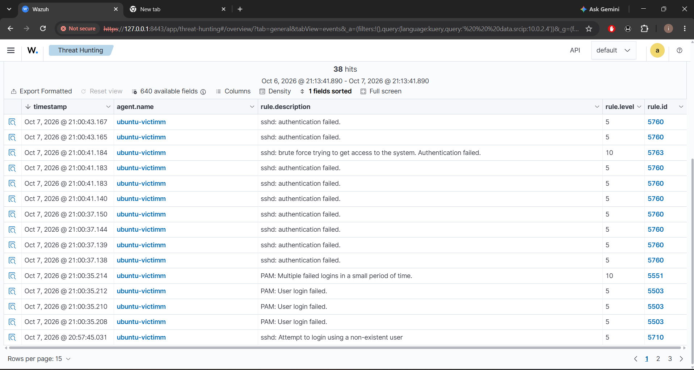

## Lab environment

| Component | Evidence |
| --- | --- |
| Virtualization | Oracle VirtualBox |
| Monitoring platform | Wazuh 4.14.8; manager name `wazuh-server` |
| Monitored endpoint | Ubuntu 24.04.5 LTS, `ubuntu-victimm`, agent `001` |
| Endpoint address | `10.0.2.4` in the lab |
| Service tested | SSH on TCP port 22 |
| Test tool | Hydra 9.5, launched from the Ubuntu terminal shown in the captures |
| Investigation interface | Wazuh dashboard, accessed locally on port 8443 |

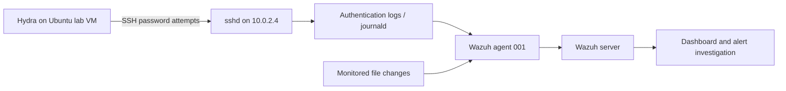

The screenshots show the same address for the SSH source and the monitored endpoint. This documents a local test on the Ubuntu VM; it does not establish a separate Kali attacker. The diagram represents the observed event flow, not a verified VirtualBox network topology.

## 1. Prepare the endpoint and SSH service

The Ubuntu console identifies the operating system and the endpoint address. The subsequent socket listing shows listeners on `0.0.0.0:22` and `[::]:22`, confirming that SSH is listening locally.

<details>
<summary>Evidence 01–02: Ubuntu endpoint and SSH listener</summary>

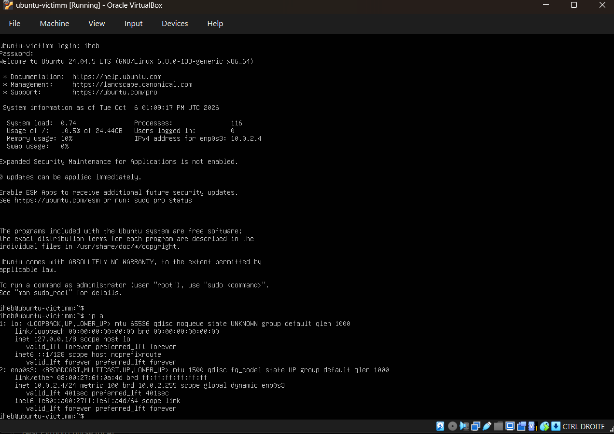
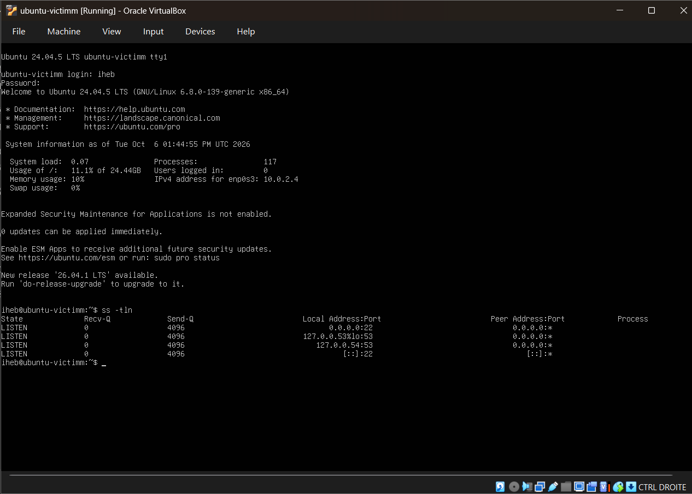

</details>

## 2. Start and enroll the Wazuh agent

The service output shows `wazuh-agent` enabled and **active (running)**, with log collector, syscheck, and other agent processes started. The dashboard then confirms agent `001` is **active**, providing evidence of enrollment beyond the local service status.

<details>
<summary>Evidence 03: Wazuh agent service</summary>

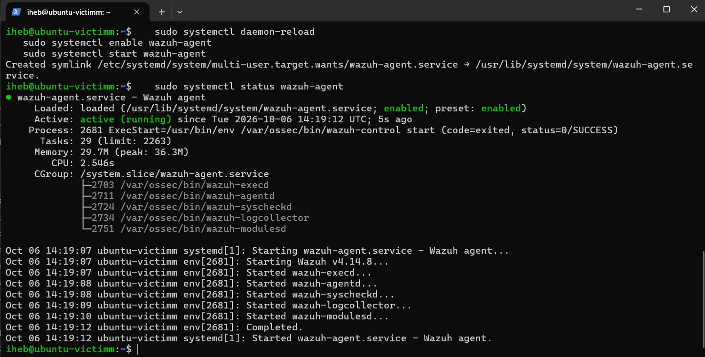

</details>

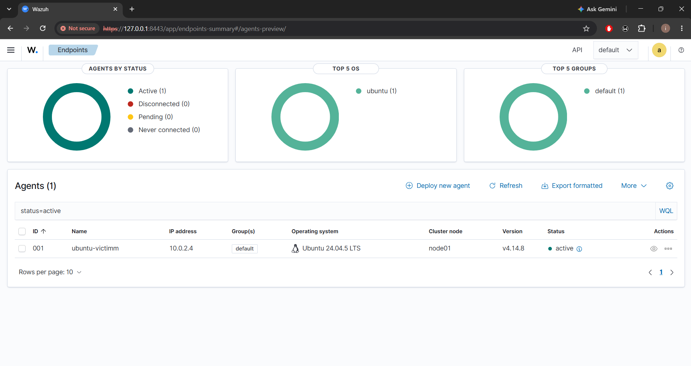

## 3. Generate controlled SSH authentication failures

Two lab runs used a small 14-entry password list and four parallel tasks. The first targeted `fakeadmin`; the second targeted the existing lab user `iheb`. Both outputs report **0 valid passwords found**. The purpose was to generate observable authentication failures, not demonstrate account compromise.

<details>
<summary>Evidence 05–06: Hydra test results</summary>

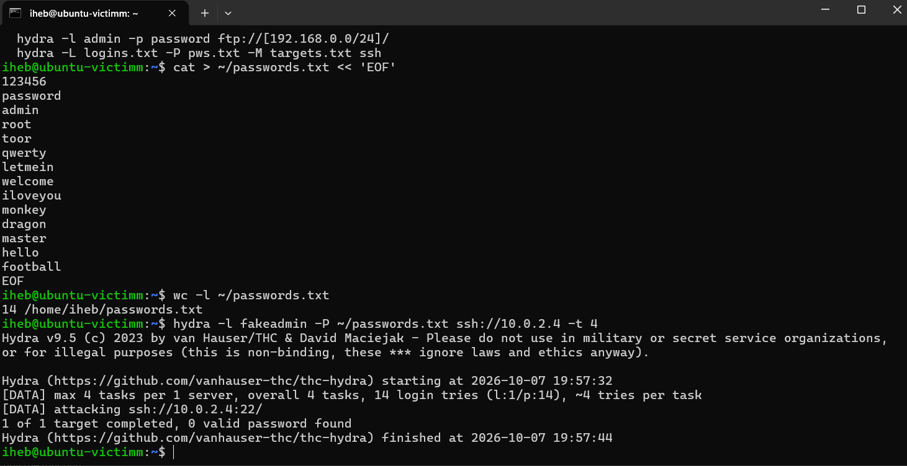
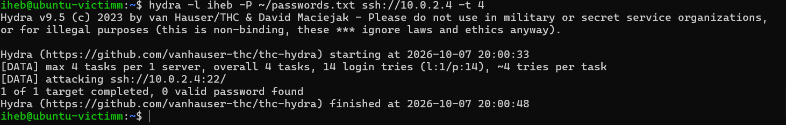

</details>

These tests concern the private lab endpoint shown in the captures. Any reproduction should be limited to systems you own or have permission to test.

## 4. Detect and investigate the activity

Filtering Threat Hunting with `data.srcip:10.0.2.4` yields **38 total alerts**, **38 authentication failures**, **0 authentication successes**, and **0 level-12-or-above alerts** in the captured dashboard. Level-10 correlation alerts are still present. These counts describe the selected view; they are not a one-to-one count of password attempts.

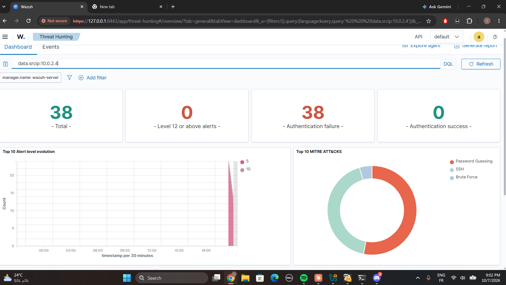

The event table exposes the following detections:

| Rule ID | Level | Description shown |
| --- | --- | --- |
| 5710 | 5 | Attempt to log in using a non-existent user |
| 5760 | 5 | SSH authentication failed |
| 5763 | 10 | SSH brute force trying to get access; authentication failed |
| 5503 | 5 | PAM user login failed |
| 5551 | 10 | Multiple failed PAM logins in a small period of time |

The transition from individual failures to a level-10 correlation alert is the key detection outcome. The screenshot shows rule matches and levels, but not the underlying rule definitions or exact thresholds.

Opening an individual alert exposes the endpoint, source IP, destination user, SSH decoder, and raw log. The captured event contains a failed password for `iheb` from `10.0.2.4`, source port `33470`, with `journald` as the event location. This links a dashboard entry back to a concrete authentication record.

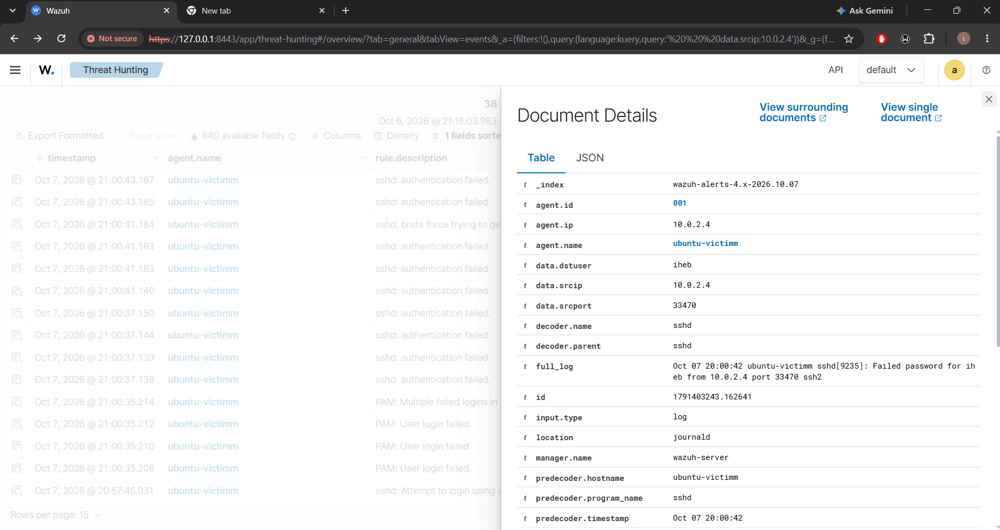

The raw log displays `20:00:42`, while the corresponding dashboard row displays approximately `21:00:43`. The captures therefore use different displayed time contexts; they should not be used to claim a one-hour detection delay or calculate detection latency.

## 5. Extend monitoring to file integrity

The configuration screenshot shows an edit to `/var/ossec/etc/ossec.conf`, including a 30-second scan frequency and a directory entry for `/etc/wazuh-test`:

```xml
<frequency>30</frequency>
<directories check_all="yes" report_changes="yes" realtime="yes">/etc/wazuh-test</directories>
```

This is a transcription of the visible excerpt, not a complete configuration file. The editor's asterisk indicates unsaved changes at capture time. Later screenshots independently demonstrate file integrity alerts, but do not expose their file paths or prove that this exact editor state was saved and loaded.

<details>
<summary>Evidence 10: File integrity configuration edit</summary>

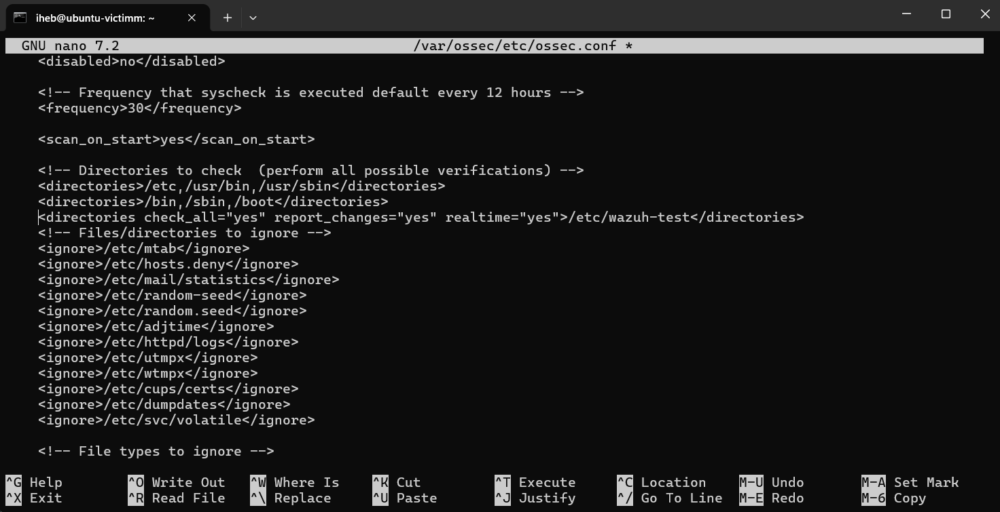

</details>

| Observed event | Rule ID | Level |
| --- | --- | --- |
| File added to the system | 554 | 5 |
| File deleted | 553 | 7 |
| Integrity checksum changed | 550 | 7 |

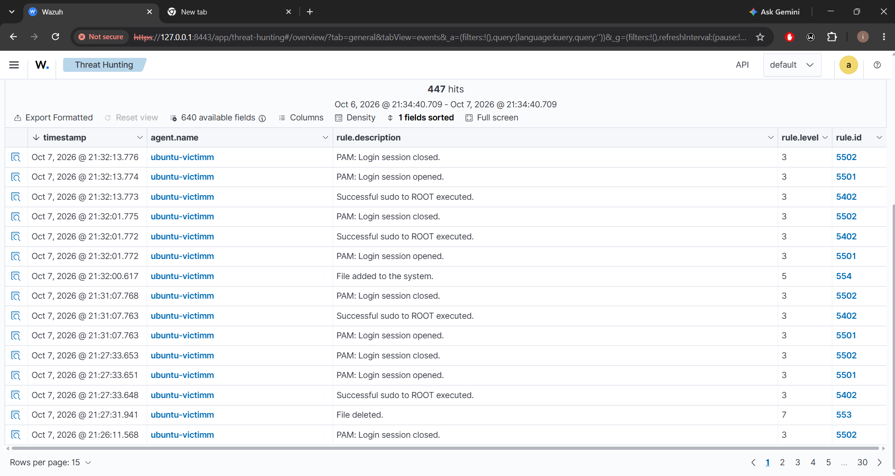
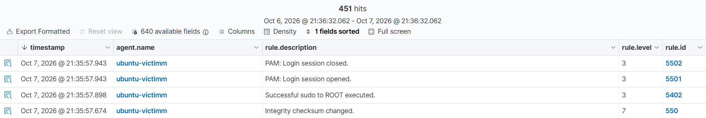

The totals of 447 and 451 in these later views include other events, such as sudo and PAM sessions; they are not counts of file integrity alerts.

## Skills demonstrated

- Linux VM and SSH service verification.
- Wazuh agent startup, enrollment, and endpoint status validation.
- Controlled generation of authentication failures.
- Alert filtering, rule-level interpretation, and raw-log investigation.
- File integrity monitoring configuration and event review.
- Evidence-based technical documentation.

## Scope and next improvements

This repository documents the supplied screenshots rather than a complete, reproducible deployment. The observed SSH detections use existing Wazuh rule IDs; custom rule authoring is not demonstrated. A separate Kali VM, automated blocking, successful compromise, and exact detection thresholds are also outside the captured evidence.

Useful next steps are to preserve sanitized configuration files and JSON alert exports, document the VM network settings, add and test a custom rule with its source, and expand a FIM alert to capture the changed path and hashes.

## CV wording

**English:** Built a Wazuh mini SOC lab to monitor an Ubuntu VM, detect simulated SSH brute-force activity, investigate authentication alerts, and validate file integrity monitoring through documented screenshots.

**Français :** Mise en place d'un mini SOC avec Wazuh : supervision d'une VM Ubuntu, détection de tentatives de brute force SSH, analyse des alertes d'authentification et validation de la surveillance de l'intégrité des fichiers.

## Evidence selection

Twelve original screenshots are retained, renamed in walkthrough order, and embedded above. Duplicate networking captures, boot output, the initial dashboard without enrolled agents, failed SSH connections, and command-typing errors were omitted to keep the portfolio focused. Images are preserved without alteration.
